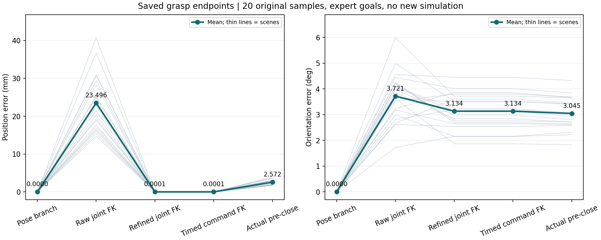
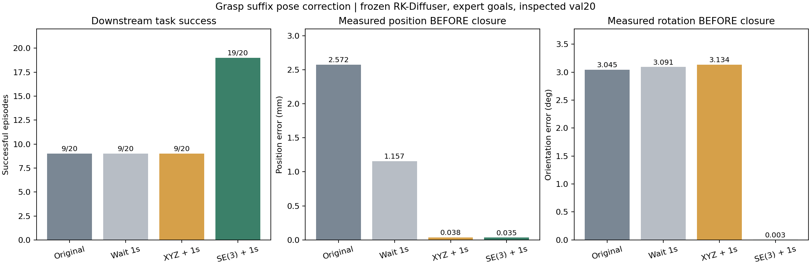
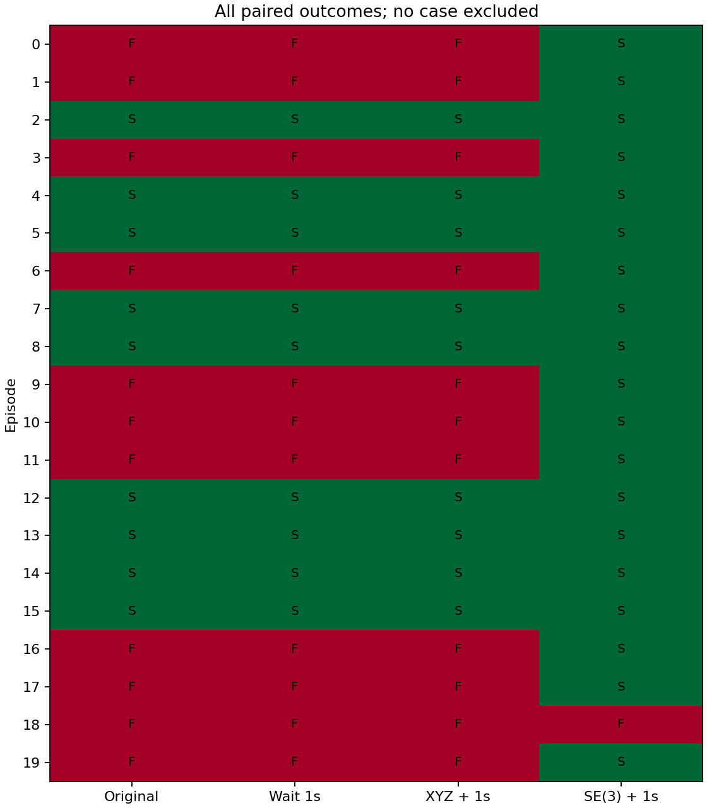

# HDP 抓取阶段完整位姿残差的诊断与动机实验

整理日期：2026 年 10 月 22 日。本文覆盖本组的问题发现、误差定位和改进必要性验证，供小组报告的动机实验部分使用。联合轨迹优化、自适应修正窗口等后续方法不属于本文已完成的贡献。

## 摘要

Hierarchical Diffusion Policy（HDP）通过高层预测下一关键末端位姿，并由低层 RK-Diffuser 生成关节轨迹。尽管原方法利用可微运动学提高关节轨迹与末端位姿轨迹的一致性，我们在单任务本地复现中发现：位姿分支的完整目标约束未充分落实到精炼后的关节终点。对于 20 个已用于开发分析的验证场景，精炼后的平均规划位置误差小于 0.001 mm，但仍有 3.13° 的平均朝向误差；实际闭合前与最终指令之间的平均朝向差仅为 0.19°，说明约 3° 的残差在执行前已经存在。进一步在冻结权重、固定专家目标和后续策略的条件下开展四组配对对照，共完成 80 次正式执行。原抓取、额外等待和仅修正位置均为 9/20 成功，完整位姿修正达到 19/20；相对两个主要对照均提高 50 个百分点，场景配对 bootstrap 95% 置信区间为 [30, 70] 个百分点。结果支持进一步改进关键抓取阶段的完整位姿精炼，但不证明旋转误差是所有失败的唯一原因，也不构成对作者原检查点或完整 HDP 的性能复现。

## 1. 研究背景

HDP 将操作分为高层目标预测与低层连续运动生成：

> 语言指令和场景观测 → PerAct 预测下一关键末端位姿及夹爪动作 → RK-Diffuser 生成关节轨迹 → 机械臂执行 → 后续阶段。

末端位姿同时包含位置和朝向。低层 RK-Diffuser 学习末端位姿轨迹与关节位置轨迹，并通过可微正向运动学（FK）建立两者的对应关系。位姿扩散在去噪过程中固定起始位姿和目标位姿；对于冗余的 7 自由度机械臂，同一个 6 自由度末端目标可能对应多种关节构型，因此关节扩散只直接固定初始关节状态，再通过推理阶段的运动学精炼接近位姿轨迹。[原论文第 4.3 节](https://arxiv.org/html/2403.03890v1#S4.SS3)

这意味着需要区分三层准确性：

1. 给定的目标位姿是否正确；
2. 生成并精炼后的关节轨迹，在运动学模型中是否到达该完整位姿；
3. 实际执行后，在夹爪闭合这一关键事件前是否准确到位。

原论文已经考虑朝向，也已经优化关节轨迹。本文研究的是这些机制之后仍然存在的残余误差及其操作后果，不将问题表述为“作者没有考虑朝向”或“作者没有做优化”。

## 2. 发现的问题与研究问题

### 2.1 官方实现中的具体取舍

在本组使用的官方代码中，`rk_diffuser/robot.py` 的 `inverse_kinematics_autodiff_single_step_batch_pt` 同时计算平移误差 `t_err` 和四元数误差 `r_err`，但实际反向传播使用的是：

```python
# The implementation reports unstable rotation optimization.
loss = t_err
```

代码注释说明，作者观察到旋转优化不稳定，因此仅优化平移，并依赖预测关节位置提供较好的初值。`MultiLevelDiffusion.conditional_sample` 会进行全轨迹精炼，并进一步单独精炼最后一点；这两处调用使用同一个位置优化函数。

因此，本研究关注的具体局限是：**位姿分支虽然固定完整目标位姿，但执行的关节轨迹经现有精炼后，朝向残差仍可能保留；这种残差可能影响关键抓取事件及后续操作。** 这是对已知实现取舍的实际后果进行验证，而不是证明作者不知道旋转的重要性。

### 2.2 动机实验要回答的问题

- **问题一：误差来源。** 抓取位姿误差在规划终点就存在，还是主要由轨迹过滤、时间参数化或实际执行引入？
- **问题二：实际影响。** 在正确专家目标下，闭合前的完整位姿修正能否改善后续拉门？收益能否被额外等待或仅修准位置解释？

问题一由已保存轨迹的离线追溯回答；问题二由四组配对干预实验回答。

## 3. 实验平台与范围

| 项目 | 实际设置 |
| --- | --- |
| 硬件和系统 | 单张 RTX 5080（16 GB）；Windows 主机，WSL Ubuntu 20.04 |
| 仿真与依赖 | RLBench / PyRep，CoppeliaSim Edu 4.1；Python 3.10、PyTorch 2.7.1 + CUDA 12.8 |
| 任务 | `open_microwave`，variation 0；抓取和拉门两阶段 |
| 低层模型 | 本组简化训练的 RK-Diffuser，seed 7，100 条训练示范、20,000 次更新 |
| 保留的模型设置 | 关节与位姿两个分支；轨迹长度 64，扩散步数 100 |
| 训练设置 | batch size 16、梯度累积 4、学习率 2×10⁻⁵、float32 |
| 高层目标 | 专家关键帧的抓取和拉门位姿、专家夹爪指令；未训练或运行 PerAct |
| 主实验场景 | 20 个已用于多轮分析的验证场景，场景种子 200000–200019 |
| 权重 | 冻结本地 `open_microwave-seed7-u20000.pt`；实验期间未重新训练 |
| 任务成功 | 沿用 RLBench 原任务的门关节 80° 条件，不以位姿达标或接触读数代替任务成功 |

本实验不是原论文多任务、多个训练种子的完整复现。这里的“原抓取”是当前本地冻结模型按既有流程产生的抓取，而不是作者公开检查点的结果。

为减小本机机器人几何与运动学计算之间的不匹配，推理与离线分析使用由训练场景导出的仿真几何链。该链没有按验证成功率拟合；既有关键帧 FK 检查的平均位置/朝向误差约为 0.477 mm / 0.025°。网络权重没有因此重新训练，训练时的旧运动学监督仍属于本实验限制。规划中的极小位置误差是该运动学模型下的计算结果，不表示真实机器人具有相同的物理精度。

## 4. 实验一：误差从哪里产生？

### 4.1 设计

复用 20 个场景已经保存的同一批原始抓取预测，依次读取：

1. 位姿扩散分支的终点；
2. 原始关节扩散预测的终点；
3. 运动学精炼后的关节终点；
4. 轨迹过滤后的关节终点；
5. 时间参数化后实际下发的最终关节指令；
6. 夹爪闭合前、闭合后的实测末端位姿。

关节终点通过同一仿真几何 FK 换算为末端位姿。位置误差采用欧氏距离；朝向误差采用 SO(3) 测地角，不直接相减四元数，因此不受四元数正负等价表示的影响。

除各状态相对专家目标的误差外，另计算“实际闭合前位姿与最终指令 FK 的差”，用于区分规划残差与执行差异。误差模长和旋转角不可直接相加，不以均值之比解释所谓的误差责任百分比。

本项仅离线读取既有数据，没有新增仿真回合、模型采样或几何拟合。项目迁移后的工程冒烟检查另存于 `local/`，不计入原正式实验。

### 4.2 结果

**表 1：原抓取误差链，20 个场景均值。**

| 环节 | 相对专家目标的位置误差 / mm | 相对专家目标的朝向误差 / ° |
| --- | ---: | ---: |
| 位姿分支终点（目标直接固定） | 0 | 0 |
| 原始关节预测的 FK 终点 | 23.4961 | 3.7208 |
| 运动学精炼后的 FK 终点 | 0.000126 | 3.1343 |
| 轨迹过滤后的 FK 终点 | 0.000126 | 3.1343 |
| 时间参数化后的最终指令 FK | 0.000126 | 3.1343 |
| 实际闭合前 | 2.5722 | 3.0450 |
| 实际闭合后 | 1.0119 | 3.0967 |



进一步检查发现：

- 20/20 场景的精炼后规划位置误差小于 0.001 mm，但规划朝向误差均超过 1°，范围约为 1.87°–4.45°。
- 实际闭合前与最终指令 FK 的平均差为 **2.5723 mm / 0.1932°**；朝向差最大约为 0.364°。
- 过滤后的终点关节值在 20/20 场景保持不变。时间参数化后 18/20 完全相同，其余仅有浮点舍入，最大关节差约为 1.86×10⁻⁹ rad，不足以解释约 3° 的残差。
- 精炼使 15/20 场景的目标朝向误差减小，另 5/20 增大；总体从 3.72° 降为 3.13°。因此不能说位置精炼普遍“破坏朝向”，准确表述是它没有显式约束并充分消除朝向残差。
- 实测关节 FK 与最终指令 FK 的平均差为 2.1398 mm / 0.1769°；实测关节 FK 与实测末端的平均差为 0.5376 mm / 0.0296°。执行位置残差不能全部简单归为电机误差。

### 4.3 本项结论

**约 3° 的抓取朝向残差在运动学精炼后的规划终点已经存在，主要不是实际执行时新产生的。** 另一方面，执行过程还存在毫米级位置偏差。后续方法应区分规划完整位姿约束与实际跟踪两部分，而不是把全部误差归于高层目标或执行器。

## 5. 实验二：完整位姿残差是否有实际操作影响？

### 5.1 配对控制

在同一批 20 个场景中比较四组条件，共 80 次正式执行。固定模型权重、原模型抓取样本、专家抓取目标、专家拉门目标和夹爪指令；每次执行使用独立仿真进程。

所有干预只能改变名义抓取执行时间的最后 25%。干预前的指令、物理状态和运动历史保持一致。原抓取组作为自然基线，另外三组都在夹爪闭合前额外使用固定 1 秒，以控制多等一秒的影响。

| 组别 | 闭合前处理 | 用途 |
| --- | --- | --- |
| ORIGINAL：原抓取 | 原关节轨迹、原闭合时刻 | 当前冻结模型基线 |
| HOLD：额外等待 | 同一轨迹，保持原关节终点 1 秒再闭合 | 检查额外等待、稳定下来是否解释收益 |
| XYZ：仅修正位置 | 末段对齐专家位置，保留原规划朝向；额外 1 秒测量反馈伺服 | 检查仅提高位置精度是否足够 |
| SE3：完整位姿修正 | 末段对齐专家位置和朝向；额外 1 秒测量反馈伺服 | 检查完整位姿干预的效果 |

XYZ 并非任意改变朝向：其控制目标采用专家位置和原规划终点朝向。SE3 使用专家完整位姿。两组采用相同类型的数值求解和反馈机制。

后续拉门使用同一冻结 RK-Diffuser、同一专家目标和配对的扩散随机种子 `80000 + episode × 100 + 1`。每组根据各自实际闭合后的 RGB-D、关节状态和末端位姿重新生成一次拉门轨迹。因此“固定后续策略”指固定权重、目标和随机种子，不是强制重放完全相同的拉门关节序列。

### 5.2 干预实现及预算

末段采用五次平滑权重引入目标修正，利用阻尼最小二乘求解关节调整；随后的固定 1 秒伺服使用实测机器人末端和关节状态，在前一个电机目标上累加测量残差。控制只写关节目标，不瞬移机器人或门。

| 参数 | 设置 |
| --- | --- |
| 可修改窗口 | 名义抓取时间最后 25% |
| 离线 DLS 迭代上限 | 100 |
| 阻尼、旋转长度尺度 | 10⁻⁴；0.1 m/rad |
| 单次 IK 关节步长上限 | 0.03 rad |
| 相对原指令的每关节信赖域 | ±0.35 rad |
| 额外伺服 | 固定 1 秒，增益 0.8，单步关节调整上限 0.02 rad |
| 约束 | 真实关节限位及关节目标速度限制 |
| 后续拉门预算 | 15 秒；共同整段物理预算 40 秒 |

修正过程不读取门角、门进度或接触状态作为反馈，也没有使用重抓、失败重试或新增视觉模块。门状态和接触记录仅用于事后诊断。

### 5.3 指标与统计

主要指标为后续开门成功率。闭合前、后的末端位置和朝向误差用于确认干预是否到位。预设 **位置≤0.5 mm 且朝向≤0.2°** 作为完整位姿达标诊断，但该阈值不是任务成功判据，也不是已发现的最低必要精度；未达标或失败的案例均保留在分母。

两项主要配对比较为 SE3–HOLD、SE3–XYZ。以场景为配对单位，使用 4,000 次 bootstrap 重采样估计成功率差的 95% 置信区间，使用不一致配对的双侧精确二项检验，并对两项主要比较进行 Holm 修正。区间不包含训练种子不确定性，也不能消除场景曾用于开发分析带来的局限。

### 5.4 主要结果

**表 2：四组正式结果；误差为实际闭合前测量的均值。**

| 组别 | 成功数 | 成功率 | 位置误差 / mm | 朝向误差 / ° | 完整位姿达标 |
| --- | ---: | ---: | ---: | ---: | ---: |
| ORIGINAL | 9/20 | 45% | 2.5722 | 3.0450 | 0/20 |
| HOLD | 9/20 | 45% | 1.1569 | 3.0914 | 0/20 |
| XYZ | 9/20 | 45% | 0.0384 | 3.1335 | 0/20 |
| SE3 | **19/20** | **95%** | **0.0350** | **0.0033** | **20/20** |



ORIGINAL、HOLD 和 XYZ 三组的逐场景成败完全一致。SE3 相对两项主要对照均改善 10 个场景，没有变差场景：

- 成功率差：**+50 个百分点**；
- 场景配对 bootstrap 95% 置信区间：**[+30, +70] 个百分点**；
- 双侧精确检验：`p = 0.001953125`；
- 两项主要比较经 Holm 修正：`p = 0.00390625`。

额外等待未复现收益；XYZ 与 SE3 的实际位置精度接近，平均位置误差分别为 0.0384 mm 和 0.0350 mm，而成功率明显不同。两组实际闭合前位置向量的平均差约为 0.0224 mm，最大约为 0.1078 mm。这支持完整位姿修正具有超出单独修准位置的价值。

样本中等待组和位置组没有观察到成功率变化，不等于已证明其在所有场景下无效，也不以零宽 bootstrap 区间宣称等价。

### 5.5 过程指标与残余失败

**表 3：后续拉门过程的描述性指标。**

| 指标 | ORIGINAL | HOLD | XYZ | SE3 |
| --- | ---: | ---: | ---: | ---: |
| 拉门双侧手指—门接触采样占比 | 0.411 | 0.392 | 0.393 | 0.982 |
| 拉门前 1 秒相对位置最大漂移的场景均值 / mm | 47.241 | 45.751 | 46.488 | 3.199 |

这些观测与修正后接触保持改善相一致，但手指—门碰撞接触不等于稳定夹住把手或实现力闭合。提前成功、轨迹结束和持续时间也会影响过程指标，不能将其作为独立的因果证明。

SE3 唯一失败场景为 episode 18：闭合前误差约为 0.0307 mm / 0.00336°，闭合后也达标，但门在约 56.87° 时拉门轨迹结束，未满足任务条件。因此，准确完成当前抓取目标不足以保证所有后续操作成功；该残余失败的具体原因尚未隔离。



## 6. 证据完整性与工程处理

主实验保留全部 80 份正式案例、160 份抓取/拉门物理轨迹、80 份抓取控制记录和 80 个新拉门样本。20/20 场景的共同前缀状态、实际运动与接触记录逐项一致；目标、夹爪指令及后续策略种子配对一致。最终指令速度限制检查通过，最大速度比约为 0.412。

正式执行前共进行 7 次工程检查，包含初轮四组检查、伺服实现修订后的两组复查及一次独立原组重复；均不混入正式 80 次。修订解决了在实测关节角上重复重建目标导致的负载稳态偏差，旧协议和工程记录保留，固定预算与阈值没有按任务成功数调整。

80 例均在首次正式尝试留下完整科学记录。episode 7 的 SE3 进程在完整结果写入后以原生退出码 -11 结束；其记录通过相同的数据核验后保留，没有因该退出码重跑。退出原因尚未定位。

离线误差追溯进一步核对了 20 份源抓取预测、80 份控制记录及其快照；所有闭合前、后已存位姿误差均重新计算一致。既有 FK 数值验证复用。当前完成的相关验证包括 6 项不同的抓取控制/分析定向检查，以及 3 项误差追溯检查；没有为报告整理重跑物理实验、训练或无关的全量测试。

## 7. 辅助证据与未采用的解释

早期阶段替换实验提供了问题线索：模型抓取→模型拉门为 9/20，专家抓取前缀→模型拉门为 18/20，专家全程回放为 20/20。它提示抓取前缀留下的状态值得研究，但替换整个前缀也改变了关节构型、接触历史和后续观测，不能定位单一机制。该批采用近似状态配对，与本报告的独立进程正式四组实验不同，不将其成功率合并统计。

此前还探索过动态失败判断与恢复、门运动约束、拉门朝向修正和真实门进度调速。这些结果没有建立“动态反馈必不可少”“位置精炼导致朝向破坏并造成失败”或“按门进度调速提高成功率”的充分证据，因此不作为当前方法贡献。这些探索不构成当前贡献；按项目整理要求，非主线代码、旧方案和对应冗余产物已移除，本报告只保留直接支持当前动机的证据。

## 8. 可以得出的结论及边界

### 8.1 已有证据支持的结论

1. 当前本地模型在正确专家目标下，经过既有运动学精炼后仍存在抓取朝向残差。
2. 约 3° 的朝向残差在规划终点已存在，轨迹过滤和时间参数化不是其主要来源；执行还引入额外的位置偏差。
3. 在当前场景中，闭合前完整位姿修正显著改善后续拉门；额外等待和仅修准位置没有复现该改善。
4. 官方位置精炼的实现取舍与该现象一致，为完整位姿精炼的后续方法研究提供了具体动机。

### 8.2 不能据此宣称的结论

- 不能说作者未考虑朝向或未优化轨迹；本文针对其实现取舍之后的残余误差。
- 不能说旋转误差是所有失败的唯一原因。完整修正也改变了关节构型、接近过程、接触历史和下游观测。
- 不能说仅离线规划修正或仅在线伺服独立实现了全部收益；现有主干预组合使用二者。
- 不能把这 20 个已分析验证场景当作独立未见测试集，或将区间解释为多训练种子泛化保证。
- 不能把本地简化模型的 45%/95% 当作作者完整 HDP 的成功率。
- 不能据此认为高层预测错误时，精确执行仍会有同样收益；本文用的是专家目标。
- 不能把传统 DLS 与末端伺服本身包装成新算法，也不能将本地运动学适配的工程收益混入本文主要贡献。

## 9. 对小组后续方法部分的交接

本组已完成“发现问题—定位误差来源—配对干预验证”的核心动机链。后续方法可研究在冻结模型下，将完整位姿目标约束落实到关节轨迹，并在保留扩散轨迹特征的同时满足平滑性与执行限制。

后续应以现有完整位姿修正为强基线，区分单纯加入旋转误差、联合末段优化和实际反馈伺服的作用。若提出自适应修正窗口或任务相关容差，需要新增实验验证其相对已有修正的成功率或执行成本价值。上述方案属于待研究的方法，不计入本文已完成结果。

## 10. 可直接用于小组报告的总结段

> 我们针对 HDP 中高层目标位姿向低层关节轨迹传递的过程开展动机实验。在正确专家目标和冻结低层模型条件下，离线追溯发现现有运动学精炼虽将规划位置误差降至接近零，但仍留下平均约 3.13° 的抓取朝向残差，该残差在实际执行前即已存在。进一步在 20 个验证场景中进行四组配对实验：原抓取、额外等待和仅位置修正均为 9/20 成功，而闭合前完整位姿修正达到 19/20，相对两个主要对照提高 50 个百分点。结果支持关键抓取事件处完整位姿实现精度具有实际操作意义，为改进关节轨迹的完整位姿精炼提供了依据。结论限于当前单任务、单训练种子和已分析场景，不将收益归因于旋转这一唯一因素。

## 11. 数据与代码索引

当前正式科学记录和数组保留；路径元数据已改为仓库相对路径，源预测和源计划改为独立目录。迁移前主要 JSON 原件在本地忽略的 `local/original-main-records.zip` 保存。报告插图为现有结果图的副本。

| 内容 | 文件或目录 |
| --- | --- |
| 工作区总导航、Windows/WSL 路径 | [工作区 README](../../README.md) |
| 实验代码与依赖分类 | [实验目录 README](../../outputs/single-gpu-study/README.md) |
| 正式四组原始结果 | [grasp-pose-val.json](../../outputs/single-gpu-study/results/grasp-pose-val.json) |
| 正式结果与配对统计 | [grasp-pose-val-summary.json](../../outputs/single-gpu-study/results/grasp-pose-val-summary.json) |
| 正式数据核验 | [grasp-pose-val-audit.json](../../outputs/single-gpu-study/results/grasp-pose-val-audit.json) |
| 正式逐场景表 | [grasp-pose-val-episodes.csv](../../outputs/single-gpu-study/results/grasp-pose-val-episodes.csv) |
| 80 例原始控制、预测和物理轨迹 | [grasp-pose-val-cases](../../outputs/single-gpu-study/results/grasp-pose-val-cases/) |
| 冻结实验协议 | [grasp-pose-protocol.json](../../outputs/single-gpu-study/results/grasp-pose-protocol.json) |
| 离线误差来源统计 | [grasp-error-origin-val.json](../../outputs/single-gpu-study/results/grasp-error-origin-val.json) |
| 离线计划终点逐场景表 | [grasp-error-origin-val-plans.csv](../../outputs/single-gpu-study/results/grasp-error-origin-val-plans.csv) |
| 离线四组状态追溯表 | [grasp-error-origin-val-cases.csv](../../outputs/single-gpu-study/results/grasp-error-origin-val-cases.csv) |
| 离线数据核验 | [grasp-error-origin-val-audit.json](../../outputs/single-gpu-study/results/grasp-error-origin-val-audit.json) |
| 正式抓取实验入口 | [grasp_pose_experiment.py](../../outputs/single-gpu-study/grasp_pose_experiment.py) |
| 局部干预实现 | [grasp_pose_suffix.py](../../outputs/single-gpu-study/grasp_pose_suffix.py) |
| 正式统计入口 | [analyse_grasp_pose.py](../../outputs/single-gpu-study/analyse_grasp_pose.py) |
| 离线误差来源入口 | [analyse_grasp_error_origin.py](../../outputs/single-gpu-study/analyse_grasp_error_origin.py) |
| 本机运动学链 | [simulator-kinematics.json](../../outputs/single-gpu-study/results/simulator-kinematics.json) |
| 本机运动学适配 | [simulator_kinematics.py](../../outputs/single-gpu-study/simulator_kinematics.py) |
| 早期阶段替换原始结果（辅助） | [阶段替换记录](../../outputs/single-gpu-study/results/open_microwave-stage-substitution-val.json) |
| 组员复现说明 | [REPRODUCE.md](../../docs/REPRODUCE.md) |

## 参考资料

1. Ma, X., Patidar, S., Haughton, I., & James, S. *Hierarchical Diffusion Policy for Kinematics-Aware Multi-Task Robotic Manipulation*. CVPR 2024. [论文](https://arxiv.org/abs/2403.03890)。
2. HDP 官方实现：[dyson-ai/hdp](https://github.com/dyson-ai/hdp)。本地源码基线提交：`383d5323b8817e1ce9acd18b7d4ee3860e80184f`。
3. 本地原实现核对：[运动学精炼函数](../../work/hdp/rk_diffuser/robot.py)、[双分支采样与终点精炼](../../work/hdp/rk_diffuser/models/multi_level_diffusion.py)。
